  
  

## 👋 About Me

- 🎓 B.Sc. in Computer Science, **Shanghai Ocean University** (2023 – ) · GPA **3.75 / 4.0**, Rank **4 / 137**
- 🔬 Deep learning researcher in computer vision — first-author paper in a CAS Q1 TOP journal, co-first-author paper in *Ecological Informatics*, and a granted invention patent as first inventor
- 🤖 Currently building my own **Agent Harness** (agent loop / tool system / context engineering / memory) and a paper research assistant on top of it
- 💼 Looking for an **Agent / LLM application development internship**
- 📫 Reach me at **xiao_hu_tang@163.com**

## 🛠️ Tech Stack

  

## 🌟 Featured Work

- 🤖 **Paper Research Assistant** *(in progress)* — an agent built on my self-developed harness: local paper-library RAG + live web search → comparison → a literature-review draft **with citations**
- 🐟 **SeekNet — fish recognition in aquaculture** *(co-first author, Ecological Informatics, CAS Q2)* — NAS design space compressed from 10¹⁹ to 1.69×10⁶; YOLOv8-pose + LMCL, Rank-1 **95.97%** · [DOI: 10.1016/j.ecoinf.2026.103679](https://doi.org/10.1016/j.ecoinf.2026.103679)
- 🎣 **SA-QRN-ReID — non-invasive fish-face re-identification** *(first author, CAS Q1 TOP)* — Swin Transformer + ArcFace; AUC **99.34%**, Rank-1 **97.70%**
- 🦀 **Multimodal crab quality detection** *(first inventor, granted patent)* — vision + foot-pressure fusion · **CN 121564766 B**

## 📊 GitHub Stats

  
  
   
  

## 🐍 Contribution Snake

  <picture>
    <source media="(prefers-color-scheme: dark)" srcset="https://raw.githubusercontent.com/X1a0hu/X1a0hu/output/github-contribution-grid-snake-dark.svg">
    <source media="(prefers-color-scheme: light)" srcset="https://raw.githubusercontent.com/X1a0hu/X1a0hu/output/github-contribution-grid-snake.svg">
    
  </picture>

  

